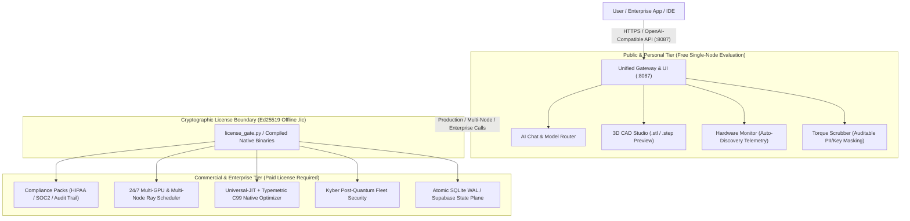

# VectorCore & ClothOS: Unified Systems Architecture

> **Open to Inspect. Built for Production. Licensed to Scale.**
> Free for personal, academic, and single-node evaluation use (`BSL-1.1`). Commercial production, multi-node clusters, SaaS, and OEM redistribution require a paid Ed25519-signed license key (`.lic`).

---

## 1. High-Level Architecture (Public Plane vs. Commercial Plane)

The system is designed as a **layered, single-port (`:8087`) platform** that separates **auditable public interfaces** (so anyone—including enterprise security teams—can verify how data is protected) from **licensed production engines** (so businesses pay to run it at scale).

---

## 2. How the Five Core Subsystems Fit Together

### 1. Privacy & AI Routing (`torque-gateway-pro`)
- **What the public sees**: A drop-in OpenAI/Ollama-compatible proxy (`:8087`) that scrubs sensitive credentials, PII, and internal tokens locally (`TorqueScrubber` + `RehydrationVault`) before any prompt touches an external LLM, and rehydrates the response on return.
- **Why businesses pay**: Enterprises get **verifiable zero-leakage**, compliance audit trails, role-based access, and multi-GPU auto-preemption so interactive users never wait behind batch jobs.

### 2. Zero-Dependency Native Acceleration (`ujit-typemetric-sdk`)
- **What the public sees**: Published C99 architecture, formal soundness proofs (`typemetric-paper/`), and single-node evaluation bindings.
- **Why businesses pay**: Database, embedded, and AI runtime vendors license compiled `.dll`/`.so` builds to eliminate VM/JIT overhead without pulling in heavy external compiler dependencies.

### 3. Post-Quantum Security & Hardware Auto-Discovery (`kyber-sentinel-suite`)
- **What the public sees**: Auditable post-quantum lattice cryptography interfaces and real-time hardware telemetry (auto-discovering NVIDIA via NVML, AMD via PDH/ADL, and peer nodes without hardcoded profiles).
- **Why businesses pay**: Fleet-wide monitoring, NIST post-quantum readiness, and multi-machine health/port auditing across Linux/Windows clusters.

### 4. Parametric 3D CAD & Scientific Engine (`clothos-cad-engine`)
- **What the public sees**: An interactive 3D CAD workbench that turns engineering parameters into real solid geometry (heat exchangers, brackets, resonators, lattices) with live browser inspection.
- **Why businesses pay**: Automated batch generation, ISO-10303-21 AP214 `.step` & binary `.stl` export pipelines, and integration into manufacturing/R&D workflows.

### 5. Atomic State & 24/7 Compute Cycle (`sqlite-wal-state` + Continuous Worker)
- **What the public sees**: A simple **Daytime Interactive / Night-time Batch** compute model:
  - **Daytime**: Interactive prompts and CAD run on the primary GPU with instant auto-preemption.
  - **Night-time / Idle**: Dual-GPU + peer-node background sweeps generate, test, and summarize findings by morning.
- **Why businesses pay**: Crash-safe **SQLite WAL** atomic state (`BEGIN IMMEDIATE` transactions, zero flat-file race conditions) and high-availability multi-node orchestration.

---

## 3. How Monetization Works Without Hiding the Architecture

| Tier | Who It's For | Price / License | What They Get |
| :--- | :--- | :--- | :--- |
| **Community / Personal** | Individuals, students, researchers | **Free (`BSL-1.1`)** | Full source visibility, single-node evaluation, local UI, basic CAD & local AI routing |
| **Pro / Team** | Startups & engineering teams | **Per-seat / Per-node** | Signed `.lic` key unlocking multi-GPU scheduling, batch `.step` CAD export, and `Typemetric-JIT` acceleration |
| **Enterprise / Air-Gapped** | Healthcare, finance, defense, R&D | **Annual site license** | Offline Ed25519 `.lic` (zero phone-home), compiled native binaries, compliance packs, and multi-node Ray cluster orchestration |
| **OEM / Redistribution** | Hardware, DB, & SaaS vendors | **Royalty / OEM agreement** | Commercial rights to embed `ujit-typemetric-sdk`, `Torque`, or `clothos-cad-engine` inside their own products |

### Why Competitors Can't Just Copy-Paste It
1. **Legal Clarity (`BSL-1.1`)**: Publicly readable for security audits, but commercial production without a license is an explicit license violation—blocking enterprise legal teams and cloud hosts from freeloading.
2. **Compiled Commercial Distributions**: Paid builds ship as native C99 `.dll`/`.so` libraries and Cython/Nuitka compiled Python wheels—not raw unprotected scripts.
3. **Cryptographic Ed25519 Gate**: Only the **public verification key** ships in the software. Your **private signing key** (`license-authority/private_key.pem`) never leaves your machine, and every enterprise feature checks a signed `.lic` payload (`org`, `product`, `max_nodes`, `max_gpus`, `features`, `expires_at`).
